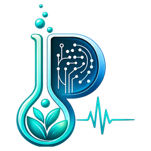
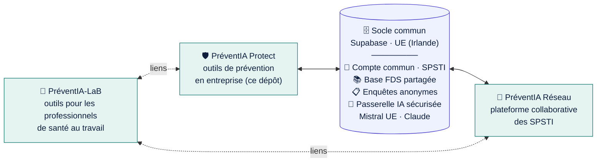
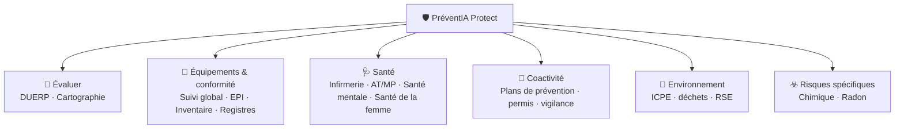
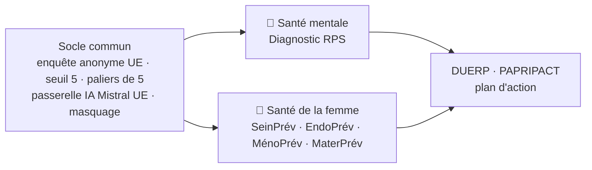
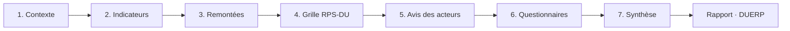
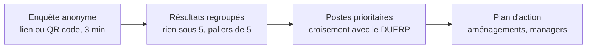
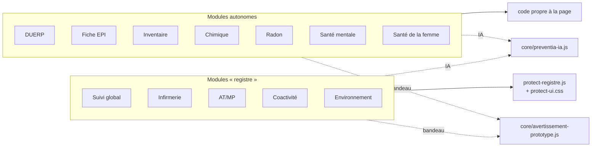
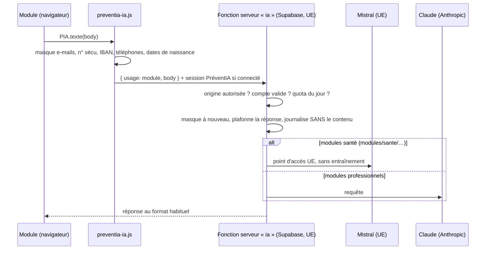
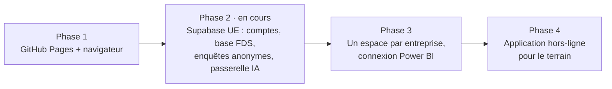

<div align="center">



# PréventIA Protect

**Plateforme HSE modulaire boostée à l'IA — Santé · Sécurité · Environnement**
*Prévenir aujourd'hui, protéger demain*

[**▶ Ouvrir la plateforme**](https://laurebonnefond.github.io/preventia-protect/) · [PréventIA-LaB](https://laurebonnefond.github.io/PreventIA-LaB/) · [Signaler un problème](https://github.com/laurebonnefond/preventia-protect/issues)


</div>

> [!IMPORTANT]
> **Prototype à visée pédagogique.** Les outils aident à préparer, structurer et suivre la prévention en entreprise. Ils ne remplacent ni la FDS du fournisseur, ni l'expertise d'un toxicologue ou d'un IPRP, ni l'avis du médecin du travail. Toute conclusion sur l'exposition ou la santé des salariés doit être validée par un professionnel.

---

## Sommaire

1. [À quoi ça sert](#1-à-quoi-ça-sert)
2. [Vue d'ensemble](#2-vue-densemble)
3. [Les modules](#3-les-modules)
4. [Projets phares : santé mentale et santé de la femme](#4-projets-phares--santé-mentale-et-santé-de-la-femme)
5. [Architecture technique](#5-architecture-technique)
6. [Comment fonctionne l'IA](#6-comment-fonctionne-lia)
7. [Données et confidentialité](#7-données-et-confidentialité)
8. [Lancer le projet en local](#8-lancer-le-projet-en-local)
9. [Ajouter un module](#9-ajouter-un-module)
10. [Réglementation intégrée](#10-réglementation-intégrée)
11. [Feuille de route](#11-feuille-de-route)
12. [Ménage technique à prévoir](#12-ménage-technique-à-prévoir)
13. [Auteure et licence](#13-auteure-et-licence)

---

## 1. À quoi ça sert

PréventIA Protect est l'une des **trois plateformes de l'écosystème PréventIA**, au même niveau que PréventIA-LaB et PréventIA Réseau. C'est une suite d'outils web, gratuits et sans installation, pour piloter la santé et la sécurité au travail dans une entreprise : évaluer les risques, suivre les équipements et les échéances, organiser la coactivité, gérer l'infirmerie, prévenir les risques psychosociaux, suivre l'environnement.

| Public | Ce qu'il y trouve |
|---|---|
| 🦺 **Responsable HSE / préventeur** | DUERP, risque chimique, registres, suivi des VGP et habilitations, plans de prévention |
| 🩺 **Infirmier·e d'entreprise** | Registre des soins, pré-dépistages, AT/MP, santé mentale, santé de la femme, protocoles d'urgence |
| 👔 **Direction, RH, CSE** | Indicateurs AT/MP anonymisés (TF, TG), tableau RSE, baromètre RPS collectif |
| 🏥 **Service de prévention et de santé au travail** | Supports d'accompagnement des adhérents, sensibilisation |

---

## 2. Vue d'ensemble

### L'écosystème PréventIA

Trois plateformes au même niveau, qui peuvent s'interconnecter. Entre PréventIA Protect et PréventIA Réseau se trouve un **socle commun** : une base de données hébergée dans l'UE, partagée par les deux.



| Plateforme | Rôle | Lien avec les autres |
|---|---|---|
| 🧪 **PréventIA-LaB** | Outils pour les professionnels de santé au travail | Liens vers Protect et Réseau ; IA encore via Make.com (migration prévue) |
| 🛡️ **PréventIA Protect** | Outils de prévention en entreprise (ce dépôt) | Socle commun : compte, base FDS, enquêtes anonymes, passerelle IA |
| 🤝 **PréventIA Réseau** | Plateforme collaborative des SPSTI (idées, expérimentations, documents) | Socle commun : même compte et même session, consultation et partage de la base FDS |

### Les domaines de PréventIA Protect



La page d'accueil (`index.html`) affiche une **carte de l'écosystème**, un **cockpit des échéances** (VGP, habilitations, vigilance URSSAF, matériel de secours…) et les **cartes des modules**, toutes générées à partir d'une seule liste `MODULES`.

---

## 3. Les modules

Légende : 🟢 **Nouveau** (version récente, utilisable) · 🟠 **Prototype** (fonctionnel, à éprouver sur le terrain) · ⚪ **À venir** (page d'attente)

### 📝 Évaluer

| Module | Statut | Ce qu'il fait | Dossier |
|---|:---:|---|---|
| **Aide au DUERP** | 🟠 | Risques par unité de travail identifiés par l'IA, cotation Gravité × Fréquence × Maîtrise, matrice de criticité, PAPRIPACT priorisé, assistant IA. Onglet **« À valider »** : reçoit les risques proposés par les modules RPS, Risque chimique et Cartographie | `modules/evaluer/duerp/` |
| **Cartographie des risques** | ⚪ | Plan de bâtiment interactif, zones liées aux unités de travail, 18 pictogrammes normalisés, envoi des risques repérés vers le DUERP | `modules/evaluer/cartographie/` |

### 🦺 Équipements & conformité

| Module | Statut | Ce qu'il fait | Dossier |
|---|:---:|---|---|
| **Suivi global** | 🟢 | Un tableau unique : habilitations, CACES, SST, VGP, maintenances, EPI, EPC. Échéance = dernière date + périodicité, alertes J-90 / J-30 / retard | `modules/conformite/suivi-global/` |
| **Fiche EPI personnalisée** | 🟠 | Fiche visuelle par métier avec silhouette SVG, EPI indispensables et conseillés, EPC, impression en affiche (33 pictogrammes ISO 7010) | `modules/equipements/epi/` |
| **Inventaire intelligent** | 🟠 | Registre EPI, EPC et machines, scan IA par photo, lecture des certificats et rapports VGP | `modules/equipements/inventaire/` |
| **14 registres obligatoires** | 🟠 | Contenu attendu, statut de conformité, base réglementaire et durée de conservation de chaque registre | `modules/conformite/registres/` |

### 🩺 Santé

| Module | Statut | Ce qu'il fait | Dossier |
|---|:---:|---|---|
| **Infirmière d'entreprise** | 🟢 | Registre des passages pseudonymisé, pré-dépistages Visio et Audio, trousses et DAE, couverture SST, actions de prévention, [protocoles d'urgence](modules/sante/infirmiere/protocoles/) | `modules/sante/infirmiere/` |
| **Suivi AT / MP & indicateurs RH** | 🟢 | TF, TG, IF, turnover, AT par catégorie, MP par tableau, bonhomme des lésions, accidents graves > 30 j, rapport PDF au logo de l'entreprise. Vue anonyme pour direction, RH et CSE | `modules/sante/at-mp/` |
| **Santé mentale** | 🟢 | Diagnostic RPS et 6 outils d'accompagnement (détail ci-dessous, présentation au § 4.1) | `modules/sante/sante-mentale/` |
| **Santé de la femme** | 🟢 | **SeinPrév** : dépistage du cancer du sein et Octobre rose · **EndoPrév** : règles douloureuses, endométriose, adénomyose · **MénoPrév** : ménopause et travail · **MaterPrév** : grossesse, allaitement et travail · **Droits et aménagements** : assistant IA qui répond uniquement à partir de fiches vérifiées et les cite · **Postes à aménager en priorité** : analyse croisant enquêtes et postes · enquête anonyme par lien ou QR code (résultats par paliers de 5). Présentation au § 4.2 ; méthodes et sources : [`modules/sante/sante-femme/README.md`](modules/sante/sante-femme/README.md) | `modules/sante/sante-femme/` |

<details>
<summary><b>Détail du module Santé mentale</b></summary>

| Page | Contenu |
|---|---|
| `rps.html` | Diagnostic RPS à 5 sources : indicateurs (mode essentiel 9 ou complet 27, tous facultatifs ; TF et TG comparés au secteur par code NAF, non interprétés sous 50 salariés), remontées, grille RPS-DU, avis des acteurs, questionnaires anonymes (baromètre PréventIA 28 items, COPSOQ lu par rapport à la référence française). Criticité Anact, rapport, **envoi des risques au DUERP**. Étapes et calculs : [`README du module`](modules/sante/sante-mentale/README.md) |
| `indicateurs-rps.html` · `enquete-rps.html` | Saisie des indicateurs par les RH par lien sécurisé · questionnaire anonyme des salariés (aucun résultat sous 5 réponses, puis par paliers de 5) |
| `burnout.html` | Pré-dépistage du risque de burn-out |
| `violentometre.html` | Violentomètre centré sur les incivilités et la souffrance au travail |
| `reperer-agir.html` | Repérer une personne en difficulté et conduite à tenir en urgence |
| `premiers-jours.html` | « Mes 100 premiers jours » : accompagnement de l'intégration des nouveaux salariés, questionnaire mensuel, courbe d'évolution, conseils adaptés et aides complémentaires (hygiène de vie, ressources) |
| `reprendre-pied.html` | « Reprendre pied » : préparer la reprise après un arrêt, fiche servant de base de réflexion pour échanger avec la santé au travail |
| `detente.html` | Cohérence cardiaque et relaxation guidée |

</details>

<details>
<summary><b>Détail du module Santé de la femme</b></summary>

| Page | Contenu |
|---|---|
| `seinprev.html` | Dépistage du cancer du sein : rythme de suivi, score familial d'Eisinger, Octobre rose, bilan de campagne, retour au travail après un cancer |
| `endoprev.html` | Règles douloureuses, endométriose, adénomyose : bilan personnel, calendrier, droits, message d'aménagement sans diagnostic, enquête collective et plan d'action |
| `menoprev.html` | Ménopause et travail : sous-scores adaptés de la MRS, croisements avec le poste, suivi, cartographie des lieux, enquête collective |
| `materprev.html` | Grossesse et allaitement : expositions interdites ou à aménager, droits, calendrier du congé, engagements de l'entreprise |
| `assistant-droits.html` | Assistant droits et aménagements : l'IA répond uniquement à partir de fiches vérifiées (`droits-data.js`) et cite chacune |
| `analyse-postes.html` | Postes à aménager en priorité : croise les enquêtes et les postes du DUERP, score expliqué, pistes, note IA |
| `enquete.html` · `enquetes.js` | Enquête anonyme par lien ou QR code (Supabase UE) : rien sous 5 réponses, puis par paliers de 5 |
| `presentation.html` | **Dossier de présentation à la direction**, généré à partir du module (chiffres à jour), modifiable, imprimable en PDF |

Méthodes de calcul, origines et limites : [`README du module`](modules/sante/sante-femme/README.md) · protection des données : [`AIPD`](docs/AIPD-enquetes.md).

</details>

### 🤝 Coactivité · 🌿 Environnement

| Module | Statut | Ce qu'il fait | Dossier |
|---|:---:|---|---|
| **Coactivité & entreprises extérieures** | 🟢 | Plans de prévention (statut, inspection commune, forme écrite automatique), attestations de vigilance à 6 mois, permis de feu, consignations, protocoles de chargement | `modules/coactivite/plans-prevention/` |
| **Environnement RSE & ICPE** | 🟢 | Rubriques ICPE et régimes (NC / D / DC / E / A), contrôles et rejets, registre déchets + Trackdéchets, tableau RSE E / S / G, calculateur TF / TG | `modules/environnement/rse-icpe/` |

### ☣️ Risques spécifiques

| Module | Statut | Ce qu'il fait | Dossier |
|---|:---:|---|---|
| **Risque chimique** | 🟠 | Inventaire avec lecture IA des FDS (PDF ou photo), **base FDS partagée** entre SPSTI, contrôle des substances avec PubChem, évaluation hiérarchisée inspirée de Seirich, compatibilités de stockage, fiche synthétique par produit, envoi des risques au DUERP | `modules/risques/chimique/` |
| **Risque radon** | 🟠 | Zone radon par commune, scoring du bâtiment et de la ventilation, dose efficace (arrêté du 16/11/2023), seuils 300 Bq/m³ et 6 mSv/an | `modules/risques/radon/` |

<details>
<summary><b>Détail du module Risque chimique</b></summary>

```
＋ Ajouter un produit ── 📄 FDS (PDF) ─┐
                     ── 📷 photo d'étiquette ─┼─► IA ─► formulaire pré-rempli, à vérifier
                     ── 🔎 nom du produit ─┘
                     ── ✍️ saisie manuelle (+ liens pour retrouver la FDS)

① Inventaire    ② Évaluation          ③ Stockage              ④ Fiches produits
 CMR, âge FDS    danger×qté×fréquence  incompatibilités/lieu    dangers H/P, EPI, EPC
 export CSV      inhalation, cutané    rangement par groupe     conduite à tenir
                 plan d'actions S→T→O→P matrice OK / PR / INT   impression A4
```

| Fichier | Rôle |
|---|---|
| `index.html` | Page et mise en forme |
| `chim-data.js` | Référentiels : mentions H / P / EUH, classes de danger, familles, réactions dangereuses, groupes de stockage, coefficients d'évaluation, produits d'exemple |
| `chim-app.js` | Logique : inventaire, calculs, IA, affichage, éditeur, exports |
| `chim-pictos.js` | Les 9 pictogrammes SGH officiels (repris de PréventIA-LaB) |
| `chim-fds.js` | Base FDS partagée : recherche avant l'IA (même nom ou même PDF), brouillon → vérifiée → partagée au réseau, contrôle PubChem (classification harmonisée CLP, sinon notifications ECHA), liens ECHA, GESTIS, INRS |

**Base FDS partagée** (avec un compte PréventIA) :

```
Nom saisi / PDF déposé ─► déjà dans la base ? ── oui ─► repris sans IA
                                              └─ non ─► IA ─► ☁ brouillon du SPSTI ─► ✔ vérifiée ─► 🌐 partagée
```

Seul le contenu de la FDS part dans la base : jamais le lieu, l'usage, les quantités ni les salariés exposés. Consultation et gestion aussi depuis **PréventIA Réseau → Base FDS**.

Les coefficients d'évaluation sont **simplifiés** à partir de la méthode INRS ND 2233 et doivent être validés par l'équipe pluridisciplinaire.
</details>

### 🔗 Briques communes

| Brique | Rôle | Fichier |
|---|---|---|
| **Dossier entreprise** | Sélecteur en haut des pages : un dossier par entreprise suivie, bascule, export / import. Les données de santé individuelles ne sont jamais exportées | `assets/js/pp-entreprise.js` |
| **Compte commun** | Connexion avec le compte PréventIA Réseau (même session sur les deux sites), choix du SPSTI | `assets/js/pp-auth.js` |
| **Passerelle DUERP** | Les modules proposent des risques ; ils n'entrent au DUERP qu'après validation dans l'onglet « À valider » | `assets/js/duerp-passerelle.js` |
| **Passerelle IA** | Accès unique et sécurisé à l'IA (voir § 6) | `core/preventia-ia.js` |

### ⚪ Pages d'attente

Ces dossiers existent déjà et affichent une page « en construction » : `analyse-poste`, `levage`, `maintenance`, `vgp`, `controles`, `documents`, `formations`, `habilitations`, `veille`, `amiante`, `atex`, `dechets`, `incendie`, `radioprotection`, `dashboard`, `indicateurs`, `ia-predictive`.

---

## 4. Projets phares : santé mentale et santé de la femme

Deux modules portent l'essentiel de l'innovation de PréventIA Protect et la candidature à l'appel à projets « IA en santé » de Station [e]-Santé. Ils partagent le même socle : **enquête anonyme par lien ou QR code**, **croisement avec le poste de travail**, **IA encadrée** (Mistral, UE) et **méthodes de calcul publiées**.



### 4.1 Santé mentale — le Diagnostic RPS

**Le besoin.** Les entreprises doivent évaluer les risques psychosociaux dans le DUERP, mais n'ont souvent ni la méthode ni les moyens de payer une enquête menée par un psychologue. Le diagnostic donne à l'infirmier·e en santé au travail une démarche structurée, gratuite, qui croise plusieurs sources au lieu de s'en remettre à un seul questionnaire.

**Le parcours, en 7 étapes**



| Source | Ce qu'on recueille | Poids dans la synthèse |
|---|---|:---:|
| Grille RPS-DU (INRS) | 26 questions par équipe | 30 % |
| Questionnaires anonymes | Baromètre PréventIA (28 items, 4 par famille) et/ou COPSOQ (46 items, 24 échelles, validé) | 30 % |
| Avis des acteurs | Infirmier·e, médecin du travail, CSE, référents harcèlement, RH, direction, managers | 20 % |
| Remontées | Situations signalées, par gravité, non nominatives | 10 % |
| Indicateurs | Mode essentiel (9) ou complet (27), tous facultatifs ; TF et TG comparés au secteur (code NAF), non interprétés sous 50 salariés | 10 % |

**Les points forts de la méthode**
- **Sept familles de facteurs** (rapport Gollac), chacune notée de 0 à 100 : faible < 25, modéré < 50, élevé < 70, critique au-delà. Une source absente est retirée et les poids réajustés : **aucune question ni aucune étape n'est obligatoire**.
- **COPSOQ lu par rapport à la référence française** (moyenne et écart-type de l'étude de validation) : un score n'est « rouge » que s'il est plus d'un écart-type moins bon que la référence.
- **Criticité Anact** : exposition × gravité × maîtrise → priorités P1 (immédiat) à P4 (surveiller). La gravité est proposée automatiquement à partir des remontées, des indicateurs critiques et des signaux infirmiers agrégés.
- **Indice de fiabilité** (0 à 100) : nombre de sources, nombre d'avis, taux de participation.
- **Lecture assistée par l'IA**, facultative : thèmes récurrents des remontées et des notes, après masquage (entreprise, équipes, noms, e-mails, téléphones ; équipes de moins de 5 regroupées). L'utilisatrice relit exactement ce qui part, et valide la lecture avant qu'elle entre dans le rapport. **Les scores ne sont jamais calculés par l'IA.**
- **Envoi au DUERP** des familles P1 à P3, à valider dans le module DUERP.

**Garanties.** Aucun résultat de questionnaire sous 5 réponses, puis mise à jour par paliers de 5. Signaux infirmiers : uniquement des effectifs, affichés en pourcentage à partir de 5 salariés vus. Situation grave (violence, idées suicidaires repérées) : traitée hors diagnostic, sans attendre, avec le médecin du travail (INRS ED 6403).

**Limites assumées.** Les pondérations et la plupart des seuils sont des **conventions PréventIA**, inspirées de l'INRS et de l'Anact, non validées. Le baromètre est un outil de repérage, en cours de fiabilisation (cohérence interne, corrélation avec le COPSOQ). Le diagnostic aide l'employeur ; il ne remplace ni son évaluation des risques ni l'avis du médecin du travail.

**Les autres outils du hub santé mentale** : pré-dépistage du burn-out, violentomètre, repérer et agir face à une personne en difficulté, « Mes 100 premiers jours » (intégration), « Reprendre pied » (retour après un arrêt, message au manager rédigé sans aucune information de santé), cohérence cardiaque.

📄 Étapes, formules et exemples chiffrés : [`modules/sante/sante-mentale/README.md`](modules/sante/sante-mentale/README.md)

### 4.2 Santé de la femme

**Le besoin.** Endométriose, ménopause, grossesse, cancer du sein : ces étapes de vie pèsent sur le travail mais arrivent rarement jusqu'au service de santé au travail. Les salariées n'en parlent pas, les employeurs ne savent pas quoi aménager.

| Repère | Chiffre | Source |
|---|---|---|
| Endométriose | Environ 1 femme sur 10 ; errance diagnostique de 7 ans en moyenne | Stratégie nationale (réponses ministérielles, Assemblée nationale) |
| Ménopause | 400 000 à 500 000 femmes y entrent chaque année ; âge moyen 51 ans | Santé.fr |
| Cancer du sein | 61 214 nouveaux cas estimés en 2023 ; participation au dépistage organisé de 44 % en 2024 | INCa ; Santé publique France |
| Fausse couche | Environ 15 % des grossesses | Caf ; loi du 7 juillet 2023 |

| Outil | Pour la salariée | Pour l'entreprise, avec l'infirmier·e |
|---|---|---|
| **SeinPrév** | Connaître ses seins, rythme de suivi, score familial d'Eisinger, retour après un cancer | Campagne Octobre rose, freins au dépistage, bilan |
| **EndoPrév** | 8 symptômes × 8 contraintes de poste, repères HAS/CNGOF 2017, droits, message d'aménagement sans diagnostic | Enquête anonyme, plan d'action |
| **MénoPrév** | Symptômes adaptés de la Menopause Rating Scale, suivi, carte des lieux difficiles | Enquête anonyme, référent·e ménopause |
| **MaterPrév** | Expositions interdites ou à aménager (Code du travail, INRS), calendrier du congé | Engagements de l'entreprise |
| **Droits et aménagements** | Réponses sourcées à partir de 22 fiches vérifiées | Information des managers |
| **Postes à aménager en priorité** | — | Croisement enquêtes × postes du DUERP, score expliqué, pistes |

**Comment ça marche**



Le calcul croise l'intensité de chaque symptôme (0 à 3 ou 0 à 4) et le poids de chaque contrainte du poste (1 ou 2) : un score de 4 ou plus signale un croisement prioritaire.

**L'IA, toujours encadrée**
- **Assistant droits et aménagements** : l'IA ne connaît que les fiches vérifiées (Code du travail, HAS, INRS, INCa, CNGOF, ESHRE), cite chaque phrase, et une réponse sans source est signalée.
- **Analyse des postes** : la note de priorisation est rédigée à partir du seul tableau regroupé.
- **Message d'aménagement** : rédigé sans jamais mentionner la maladie ni les symptômes.

**Garanties.** Enquêtes sans nom, âge, service ni date ; seuil de 5 et paliers de 5 ; bilans personnels gardés uniquement sur l'appareil de la salariée ; hébergement UE et suppression automatique à 12 mois ; analyse d'impact rédigée ([AIPD](docs/AIPD-enquetes.md)).

**Où en est le projet**

| Élément | État |
|---|---|
| Six outils en ligne, sans compte | ✅ Fait |
| Enquête anonyme par lien ou QR code, UE | ✅ Fait |
| Méthodes de calcul et sources documentées | ✅ Fait |
| Migration « paliers de 5 » sur la base | 🟠 À appliquer |
| AIPD | 🟠 Rédigée, à valider par le DPO |
| Relecture médicale des fiches et repères | 🟠 À organiser |
| Charte d'usage signée par l'employeur | 🟠 À rédiger |
| Expérimentation dans 2 ou 3 entreprises adhérentes | 🟠 À lancer |

📄 **Dossier de présentation à la direction**, généré à partir du module et imprimable en PDF : [`presentation.html`](https://laurebonnefond.github.io/preventia-protect/modules/sante/sante-femme/presentation.html) · méthodes et sources : [`modules/sante/sante-femme/README.md`](modules/sante/sante-femme/README.md)

---

## 5. Architecture technique

### Choix de base

- **Aucune compilation** : du HTML, du CSS et du JavaScript « purs ». Chaque page s'ouvre directement dans le navigateur.
- **Un module = un dossier** avec sa propre page `index.html`, autonome.
- **Charte commune** : couleurs `oklch` (navy, teal, une couleur par domaine), polices DM Sans et DM Serif Display, mode sombre automatique.
- **Bibliothèques chargées à la demande** depuis cdnjs : Chart.js (graphiques), jsPDF + autotable et html2canvas (exports PDF), pdf.js (lecture des FDS).

### Structure du dépôt

```
preventia-protect/
├── index.html                    # Accueil : écosystème, cockpit des échéances, cartes des modules
├── assets/
│   ├── css/protect-ui.css        # Interface commune des modules « registre »
│   ├── js/protect-registre.js    # Moteur de registres (PP.app) : champs, échéances, démo, stockage
│   ├── js/pp-entreprise.js       # Dossiers entreprise (sélecteur commun)
│   ├── js/pp-auth.js             # Compte commun avec PréventIA Réseau (Supabase)
│   ├── js/duerp-passerelle.js    # Propositions de risques vers le DUERP
│   ├── styles/design-tokens.css  # Styles des pages d'attente
│   └── img/                      # Logos, favicon
├── core/
│   ├── preventia-ia.js           # ★ Passerelle IA unique (→ fonction serveur Supabase « ia »)
│   └── avertissement-prototype.js# ★ Bandeau + fenêtre « prototype pédagogique »
├── modules/
│   ├── evaluer/        duerp · cartographie · analyse-poste
│   ├── conformite/     suivi-global · registres · (pages d'attente)
│   ├── equipements/    epi · inventaire · (pages d'attente)
│   ├── sante/          infirmiere · at-mp · sante-mentale · sante-femme
│   ├── coactivite/     plans-prevention
│   ├── environnement/  rse-icpe
│   ├── risques/        chimique · radon · (pages d'attente)
│   └── pilotage/       redirection AT/MP · (pages d'attente)
└── docs/
    ├── ARCHITECTURE.md
    ├── SECURITY.md
    └── supabase-sante-mentale.sql  # Schéma prévu pour la phase 2
```

### Trois familles de pages



1. **Modules « registre »** : décrits en quelques lignes de configuration grâce à `PP.app({ title, tabs: [{ registre: {...} }] })`. Le moteur gère les tableaux, les échéances, les filtres, les données de démo et la sauvegarde.
2. **Modules autonomes** : une page complète avec sa logique propre (évaluations, calculs, graphiques).
3. **Pages d'attente** : simple page « en construction » reliée à `design-tokens.css`.

---

## 6. Comment fonctionne l'IA

Tous les modules passent par **un seul fichier** : `core/preventia-ia.js` (objet global `PIA`), qui appelle une **fonction serveur Supabase** (`ia`, hébergée dans l'UE). **Aucune clé ni aucun jeton dans le code** : les clés des IA sont des secrets du serveur.



| | Modules professionnels | Modules santé (`modules/sante/…`) |
|---|---|---|
| Qui | Professionnel **connecté** (compte PréventIA) | Salarié, **sans compte** |
| IA | Claude | **Mistral, traitement dans l'UE**, jamais de repli hors UE |
| Quota | 60 demandes / jour / personne | 15 / jour / appareil (empreinte d'IP du jour, non réversible), 500 / jour au total |
| Fichiers (PDF, photos) | Oui | Non |

- **Journal `ia_journal`** : qui, quand, quel module, nombre de jetons, statut. **Jamais le texte** envoyé ni la réponse.
- **Plafonds de dépense** fixés chez chaque fournisseur ; l'option d'entraînement des modèles sur nos appels est **désactivée** chez Mistral.
- Dans les modules qui le prévoient, l'IA est **désactivée par défaut** (interrupteur en haut de page, mémorisé dans `preventia_ai_mode`).
- Chaque résultat produit par l'IA est présenté comme **pré-rempli, à vérifier**.

---

## 7. Données et confidentialité

### Où sont les données ?

```
┌───────────────────── Navigateur de l'utilisateur ─────────────────────┐
│  localStorage  (une clé par module : pp_inf_soins, pp_coact_pdp, …)   │
│  → rien n'est envoyé sur un serveur, sauf les appels IA volontaires   │
└───────────────────────────────────────────────────────────────────────┘
          │ export / import JSON, CSV, PDF          │ appels IA (contenu filtré) · compte · base FDS · enquêtes anonymes
          ▼                                         ▼
     Fichiers de l'utilisateur              Supabase (UE, Irlande) → Mistral (UE) / Claude
```

- **GitHub Pages ne sert que des fichiers statiques.** Une base **Supabase hébergée dans l'UE (Irlande)**, partagée avec PréventIA Réseau, sert uniquement aux comptes, à la base FDS, aux enquêtes anonymes et au journal IA. Les droits d'accès par SPSTI sont imposés par la base (règles RLS).
- **Enquêtes anonymes** : ni nom, ni e-mail, ni heure de réponse enregistrés ; aucun résultat lisible sous 5 réponses ; réponses rendues dans un ordre mélangé.
- Les données restent **dans le navigateur du poste utilisé**. Changer d'ordinateur ou vider le cache les fait disparaître : utiliser les **exports** (JSON, CSV, PDF) pour sauvegarder ou partager.
- Les vues destinées à la direction, aux RH et au CSE sont **anonymes**. Les noms des salariés ne sont visibles que dans l'espace infirmier.

### Principe à deux niveaux (phase 2)

| Niveau | Données | Hébergement prévu |
|---|---|---|
| **Non médical** | Inventaires, échéances, registres, enquêtes anonymes, indicateurs collectifs | Supabase, région UE (analyse d'impact : [`docs/AIPD-enquetes.md`](docs/AIPD-enquetes.md) ; schémas : `docs/supabase-sante-mentale.sql`, `docs/supabase-enquetes.sql` — ce dernier est **en service** pour EndoPrév) |
| **Santé** | Registre infirmier nominatif, suivi individuel, dépistages | Local, ou hébergeur certifié HDS, **jamais dans Supabase** |

### Clés de stockage principales

| Préfixe | Module |
|---|---|
| `pp_suivi_global` | Suivi global |
| `pp_inf_*` | Infirmerie (soins, dépistages, matériel, SST, actions) |
| `pp_atmp*` | AT / MP |
| `pp_coact_*` | Coactivité (EE, PdP, permis, protocoles) |
| `pp_env_*` | Environnement (ICPE, contrôles, déchets, RSE) |
| `pp_rps_v*`, `pp_sm_*` | Santé mentale |
| `pp_sein_*`, `pp_meno_v*`, `pp_endo_campagnes` | Santé de la femme (EndoPrév ne garde localement que la liste des campagnes et leurs codes) |
| `pp_reg_v*` | Registres |
| `pp_entreprises`, `pp_dossier_*` | Dossiers entreprise |
| `pp_duerp_inbox` | Risques proposés au DUERP, en attente de validation |
| `pp_100j_suivi` | Suivi mensuel « Mes 100 premiers jours » |
| `pr-org` | SPSTI choisi (partagé avec PréventIA Réseau) |
| `preventia_chimique_v2` | Risque chimique (reprend automatiquement l'ancienne clé `preventia_chimique_products`) |

---

## 8. Lancer le projet en local

Certaines pages chargent des fichiers JSON : il faut un petit serveur local plutôt qu'un double-clic.

```bash
git clone https://github.com/laurebonnefond/preventia-protect.git
cd preventia-protect
python -m http.server 8000      # ou : npx serve
# puis ouvrir http://localhost:8000
```

**Mise en ligne** : toute modification fusionnée sur `main` est publiée automatiquement par GitHub Pages sur `https://laurebonnefond.github.io/preventia-protect/` (1 à 2 minutes).

---

## 9. Ajouter un module

1. **Créer le dossier** : `modules/<domaine>/<mon-module>/index.html`.
2. **Inclure les briques communes** si besoin :
   ```html
   <script src="../../../core/avertissement-prototype.js" defer></script>  <!-- bandeau prototype -->
   <script src="../../../core/preventia-ia.js"></script>                  <!-- IA -->
   ```
   Pour un module de type registre, ajouter aussi `assets/css/protect-ui.css` et `assets/js/protect-registre.js`, puis décrire les onglets avec `PP.app({...})`.
3. **Déclarer le module sur l'accueil** : ajouter un objet dans la liste `MODULES` de `index.html`.
   ```js
   { id:'bruit', dom:'risques', ic:'🔊', t:'Risque bruit', short:'Bruit', st:'proto',
     href:'modules/risques/bruit/index.html',
     p:'Description courte affichée sur la carte.',
     f:['Fonction 1','Fonction 2','Fonction 3','Fonction 4'] }
   ```
   `dom` = `evaluer` · `equip` · `sante` · `coact` · `env` · `risques`. `st` = `new` · `proto` · `plan`.
4. **(Facultatif) Pictogramme** : ajouter un tracé SVG 24 × 24 dans l'objet `PICTOS` de `index.html`, sinon l'emoji est utilisé.
5. **Stockage** : choisir une clé `pp_<module>_<donnée>` et prévoir un export JSON.

---

## 10. Réglementation intégrée

| Référence | Domaine |
|---|---|
| Code du travail, art. L4121-1 à L4121-5 | Obligation de sécurité, 9 principes généraux de prévention |
| Art. R4121-1 à R4121-4 | DUERP et PAPRIPACT |
| Art. R4323-95 et suivants · arrêté du 01/03/2004 | EPI, vérifications générales périodiques des équipements |
| Art. R4511-1 à R4515-11 · arrêté du 19/03/1993 | Coactivité, plan de prévention, travaux dangereux |
| Art. R4412-1 et suivants (dont R4412-59 à R4412-93 pour les CMR) | Risque chimique, substitution (R4412-66), système clos (R4412-68) |
| Règlement (CE) 1272/2008 (CLP) · REACH, art. 31 | Classification, étiquetage, fiches de données de sécurité |
| Méthode INRS ND 2233 · ED 753 | Hiérarchisation du risque chimique, stockage des produits |
| Arrêtés du 27/06/2018, 16/11/2023, 15/05/2024 | Radon : zonage, dose efficace, mesures |
| Code de l'environnement · nomenclature ICPE | Régimes NC / D / DC / E / A, déchets, Trackdéchets |
| Questionnaire COPSOQ · guides INRS / ANACT | Risques psychosociaux |
| HAS / CNGOF 2017 · ESHRE 2022 · Menopause Rating Scale · CNGOF-GEMVi 2021 · HAS 2025 | Santé de la femme : endométriose, ménopause, traitements |
| Code du travail (L1225-x, D4152-10, L4624-3, R4624-34) · INRS TJ 14 · INCa 2024 | Grossesse et allaitement, aménagements, retour au travail après un cancer |

---

## 11. Feuille de route



**Prochains modules envisagés** : cartographie des risques, analyse de poste, VGP et maintenance, habilitations et formations, incendie, ATEX, amiante, radioprotection, tableau de bord de pilotage, intégration de PréventIA Visio et Audio dans l'infirmerie.

**Chantiers transverses** : masquage des noms et des lieux dans les commentaires libres avant l'IA, validation de l'AIPD des enquêtes ([`docs/AIPD-enquetes.md`](docs/AIPD-enquetes.md)) et registre des traitements avec le DPO, migration « paliers de 5 » à appliquer sur la base, relecture médicale des fiches de l'assistant droits, mise à jour de pdf.js (risque chimique, version 3.11 vulnérable), assistant FDS (recherche hybride texte + vecteurs, déjà prévue dans la base), éventuel nom de domaine dédié.

**Fait en novembre 2026** : passerelle IA sécurisée (fin de Make.com pour Protect), compte commun avec PréventIA Réseau, base FDS partagée, passerelle vers le DUERP, dossiers entreprise, suppression de l'ancienne architecture inutilisée (`core/ai-*.js`, `alerts.js`, `planning.js`, `stats.js`, `storage.js`, `reglementation.js`, dossier `config/`). Diagnostic RPS : mode essentiel, TF/TG comparés au secteur, COPSOQ lu par rapport à la référence, baromètre à 28 items, documentation des calculs. Santé de la femme : enquêtes par paliers de 5, bibliothèques hébergées dans le dépôt (SheetJS 0.20.3), assistant droits sourcé, analyse des postes, dossier de présentation, AIPD des enquêtes, suppression automatique des enquêtes.

---

## 12. Ménage technique à prévoir

| Élément | Constat | Proposition |
|---|---|---|
| `index-v1.html`, `protect-ui.css` (racine) | Anciennes versions de l'accueil et de la feuille de style (la bonne est dans `assets/css/`) | Supprimer |
| `modules/risques/chimique/evaluation.html`, `index.preced.html` | Anciennes versions du risque chimique (données reprises par le nouveau module) | Supprimer après vérification |
| `modules/equipements/epi/*.prec.html` | Sauvegardes de la Fiche EPI | Supprimer (l'historique Git les conserve) |
| `modules/pilotage/at-mp/` | Simple redirection vers `sante/at-mp` | Garder tant que d'anciens liens circulent |
| `docs/Archi` | Fichier vide | Supprimer |
| Webhooks Make.com | ✅ Plus utilisés par Protect depuis la passerelle sécurisée (nov. 2026). Encore utilisés par PréventIA-LaB, dont le jeton reste visible | Migrer PréventIA-LaB vers la fonction serveur, puis désactiver les scénarios Make |

---

## 13. Auteure et licence

**Laure Bonnefond** — Infirmière en santé au travail (IDE-ST) et préventrice, SPSTI 23/87 (Creuse · Haute-Vienne)
Master IA & Data, IPSSI Bordeaux (à partir de novembre 2026)

*Des outils augmentés par l'IA au service de la prévention et de la santé au travail.*

© 2025-2026 Laure Bonnefond — Tous droits réservés.
