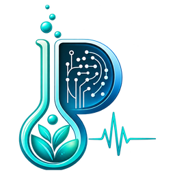
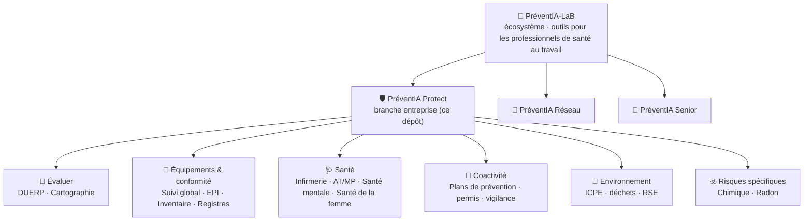
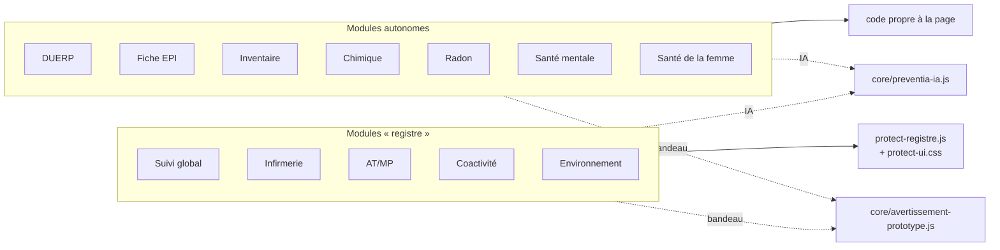
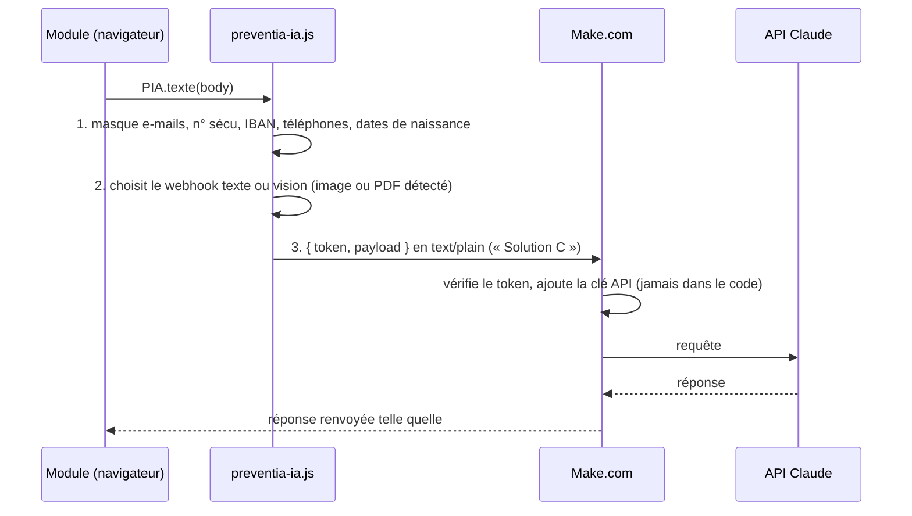
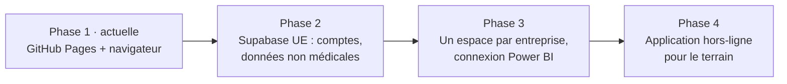

<div align="center">



# PréventIA Protect

**Plateforme HSE modulaire boostée à l'IA — Santé · Sécurité · Environnement**
*Prévenir aujourd'hui, protéger demain*

[**▶ Ouvrir la plateforme**](https://laurebonnefond.github.io/preventia-protect/) · [PréventIA-LaB](https://laurebonnefond.github.io/PreventIA-LaB/) · [Signaler un problème](https://github.com/laurebonnefond/preventia-protect/issues)


-2e7d32)

</div>

> [!IMPORTANT]
> **Prototype à visée pédagogique.** Les outils aident à préparer, structurer et suivre la prévention en entreprise. Ils ne remplacent ni la FDS du fournisseur, ni l'expertise d'un toxicologue ou d'un IPRP, ni l'avis du médecin du travail. Toute conclusion sur l'exposition ou la santé des salariés doit être validée par un professionnel.

---

## Sommaire

1. [À quoi ça sert](#1-à-quoi-ça-sert)
2. [Vue d'ensemble](#2-vue-densemble)
3. [Les modules](#3-les-modules)
4. [Architecture technique](#4-architecture-technique)
5. [Comment fonctionne l'IA](#5-comment-fonctionne-lia)
6. [Données et confidentialité](#6-données-et-confidentialité)
7. [Lancer le projet en local](#7-lancer-le-projet-en-local)
8. [Ajouter un module](#8-ajouter-un-module)
9. [Réglementation intégrée](#9-réglementation-intégrée)
10. [Feuille de route](#10-feuille-de-route)
11. [Ménage technique à prévoir](#11-ménage-technique-à-prévoir)
12. [Auteure et licence](#12-auteure-et-licence)

---

## 1. À quoi ça sert

PréventIA Protect est la **branche entreprise** de l'écosystème PréventIA-LaB. C'est une suite d'outils web, gratuits et sans installation, pour piloter la santé et la sécurité au travail dans une entreprise : évaluer les risques, suivre les équipements et les échéances, organiser la coactivité, gérer l'infirmerie, prévenir les risques psychosociaux, suivre l'environnement.

| Public | Ce qu'il y trouve |
|---|---|
| 🦺 **Responsable HSE / préventeur** | DUERP, risque chimique, registres, suivi des VGP et habilitations, plans de prévention |
| 🩺 **Infirmier·e d'entreprise** | Registre des soins, pré-dépistages, AT/MP, santé mentale, santé de la femme, protocoles d'urgence |
| 👔 **Direction, RH, CSE** | Indicateurs AT/MP anonymisés (TF, TG), tableau RSE, baromètre RPS collectif |
| 🏥 **Service de prévention et de santé au travail** | Supports d'accompagnement des adhérents, sensibilisation |

---

## 2. Vue d'ensemble



La page d'accueil (`index.html`) affiche une **carte de l'écosystème**, un **cockpit des échéances** (VGP, habilitations, vigilance URSSAF, matériel de secours…) et les **cartes des modules**, toutes générées à partir d'une seule liste `MODULES`.

---

## 3. Les modules

Légende : 🟢 **Nouveau** (version récente, utilisable) · 🟠 **Prototype** (fonctionnel, à éprouver sur le terrain) · ⚪ **À venir** (page d'attente)

### 📝 Évaluer

| Module | Statut | Ce qu'il fait | Dossier |
|---|:---:|---|---|
| **Aide au DUERP** | 🟠 | Risques par unité de travail identifiés par l'IA, cotation Gravité × Fréquence × Maîtrise, matrice de criticité, PAPRIPACT priorisé, assistant IA | `modules/evaluer/duerp/` |
| **Cartographie des risques** | ⚪ | Plan de bâtiment interactif, zones liées aux unités de travail, 18 pictogrammes normalisés | `modules/evaluer/cartographie/` |

### 🦺 Équipements & conformité

| Module | Statut | Ce qu'il fait | Dossier |
|---|:---:|---|---|
| **Suivi global** | 🟢 | Un tableau unique : habilitations, CACES, SST, VGP, maintenances, EPI, EPC. Échéance = dernière date + périodicité, alertes J-90 / J-30 / retard | `modules/conformite/suivi-global/` |
| **Fiche EPI personnalisée** | 🟠 | Fiche visuelle par métier avec silhouette SVG, EPI indispensables et conseillés, EPC, impression en affiche (33 pictogrammes ISO 7010) | `modules/equipements/epi/` |
| **Inventaire intelligent** | 🟠 | Registre EPI, EPC et machines, scan IA par photo, lecture des certificats et rapports VGP | `modules/equipements/inventaire/` |
| **14 registres obligatoires** | 🟠 | Contenu attendu, statut de conformité, base réglementaire et durée de conservation de chaque registre | `modules/conformite/registres/` |

### 🩺 Santé

| Module | Statut | Ce qu'il fait | Dossier |
|---|:---:|---|---|
| **Infirmière d'entreprise** | 🟢 | Registre des passages pseudonymisé, pré-dépistages Visio et Audio, trousses et DAE, couverture SST, actions de prévention, [protocoles d'urgence](modules/sante/infirmiere/protocoles/) | `modules/sante/infirmiere/` |
| **Suivi AT / MP & indicateurs RH** | 🟢 | TF, TG, IF, turnover, AT par catégorie, MP par tableau, bonhomme des lésions, accidents graves > 30 j, rapport PDF au logo de l'entreprise. Vue anonyme pour direction, RH et CSE | `modules/sante/at-mp/` |
| **Santé mentale** | 🟢 | Hub de 6 outils (voir ci-dessous) | `modules/sante/sante-mentale/` |
| **Santé de la femme** | 🟢 | **SeinPrév** : dépistage du cancer du sein et Octobre rose · **EndoPrév** : règles douloureuses, endométriose, adénomyose (droits, RQTH, enquête anonyme par lien ou QR code) · **MénoPrév** : ménopause et travail, 9 symptômes × 8 contraintes de poste | `modules/sante/sante-femme/` |

<details>
<summary><b>Détail du module Santé mentale</b></summary>

| Page | Contenu |
|---|---|
| `rps.html` | Diagnostic RPS à 4 sources (indicateurs, remontées, avis CSE / RH / médecin du travail, questionnaire COPSOQ anonyme), TF et TG repris du suivi AT/MP |
| `burnout.html` | Pré-dépistage du risque de burn-out |
| `violentometre.html` | Violentomètre centré sur les incivilités et la souffrance au travail |
| `reperer-agir.html` | Repérer une personne en difficulté et conduite à tenir en urgence |
| `premiers-jours.html` | « Mes 100 premiers jours » : intégration ludique des nouveaux salariés |
| `detente.html` | Cohérence cardiaque et relaxation guidée |

</details>

### 🤝 Coactivité · 🌿 Environnement

| Module | Statut | Ce qu'il fait | Dossier |
|---|:---:|---|---|
| **Coactivité & entreprises extérieures** | 🟢 | Plans de prévention (statut, inspection commune, forme écrite automatique), attestations de vigilance à 6 mois, permis de feu, consignations, protocoles de chargement | `modules/coactivite/plans-prevention/` |
| **Environnement RSE & ICPE** | 🟢 | Rubriques ICPE et régimes (NC / D / DC / E / A), contrôles et rejets, registre déchets + Trackdéchets, tableau RSE E / S / G, calculateur TF / TG | `modules/environnement/rse-icpe/` |

### ☣️ Risques spécifiques

| Module | Statut | Ce qu'il fait | Dossier |
|---|:---:|---|---|
| **Risque chimique** | 🟠 | Inventaire avec lecture IA des FDS (PDF ou photo), évaluation hiérarchisée inspirée de Seirich, compatibilités de stockage, fiche synthétique par produit | `modules/risques/chimique/` |
| **Risque radon** | 🟠 | Zone radon par commune, scoring du bâtiment et de la ventilation, dose efficace (arrêté du 16/11/2023), seuils 300 Bq/m³ et 6 mSv/an | `modules/risques/radon/` |

<details>
<summary><b>Détail du module Risque chimique</b></summary>

```
＋ Ajouter un produit ── 📄 FDS (PDF) ─┐
                     ── 📷 photo d'étiquette ─┼─► IA ─► formulaire pré-rempli, à vérifier
                     ── 🔎 nom du produit ─┘
                     ── ✍️ saisie manuelle (+ liens pour retrouver la FDS)

① Inventaire    ② Évaluation          ③ Stockage              ④ Fiches produits
 CMR, âge FDS    danger×qté×fréquence  incompatibilités/lieu    dangers H/P, EPI, EPC
 export CSV      inhalation, cutané    rangement par groupe     conduite à tenir
                 plan d'actions S→T→O→P matrice OK / PR / INT   impression A4
```

| Fichier | Rôle |
|---|---|
| `index.html` | Page et mise en forme |
| `chim-data.js` | Référentiels : mentions H / P / EUH, classes de danger, familles, réactions dangereuses, groupes de stockage, coefficients d'évaluation, produits d'exemple |
| `chim-app.js` | Logique : inventaire, calculs, IA, affichage, éditeur, exports |
| `chim-pictos.js` | Les 9 pictogrammes SGH officiels (repris de PréventIA-LaB) |

Les coefficients d'évaluation sont **simplifiés** à partir de la méthode INRS ND 2233 et doivent être validés par l'équipe pluridisciplinaire.
</details>

### ⚪ Pages d'attente

Ces dossiers existent déjà et affichent une page « en construction » : `analyse-poste`, `levage`, `maintenance`, `vgp`, `controles`, `documents`, `formations`, `habilitations`, `veille`, `amiante`, `atex`, `dechets`, `incendie`, `radioprotection`, `dashboard`, `indicateurs`, `ia-predictive`.

---

## 4. Architecture technique

### Choix de base

- **Aucune compilation** : du HTML, du CSS et du JavaScript « purs ». Chaque page s'ouvre directement dans le navigateur.
- **Un module = un dossier** avec sa propre page `index.html`, autonome.
- **Charte commune** : couleurs `oklch` (navy, teal, une couleur par domaine), polices DM Sans et DM Serif Display, mode sombre automatique.
- **Bibliothèques chargées à la demande** depuis cdnjs : Chart.js (graphiques), jsPDF + autotable et html2canvas (exports PDF), pdf.js (lecture des FDS).

### Structure du dépôt

```
preventia-protect/
├── index.html                    # Accueil : écosystème, cockpit des échéances, cartes des modules
├── assets/
│   ├── css/protect-ui.css        # Interface commune des modules « registre »
│   ├── js/protect-registre.js    # Moteur de registres (PP.app) : champs, échéances, démo, stockage
│   ├── styles/design-tokens.css  # Styles des pages d'attente
│   └── img/                      # Logos, favicon
├── core/
│   ├── preventia-ia.js           # ★ Passerelle IA unique (Make.com → API Claude)
│   └── avertissement-prototype.js# ★ Bandeau + fenêtre « prototype pédagogique »
├── modules/
│   ├── evaluer/        duerp · cartographie · analyse-poste
│   ├── conformite/     suivi-global · registres · (pages d'attente)
│   ├── equipements/    epi · inventaire · (pages d'attente)
│   ├── sante/          infirmiere · at-mp · sante-mentale · sante-femme
│   ├── coactivite/     plans-prevention
│   ├── environnement/  rse-icpe
│   ├── risques/        chimique · radon · (pages d'attente)
│   └── pilotage/       redirection AT/MP · (pages d'attente)
└── docs/
    ├── ARCHITECTURE.md
    ├── SECURITY.md
    └── supabase-sante-mentale.sql  # Schéma prévu pour la phase 2
```

### Trois familles de pages



1. **Modules « registre »** : décrits en quelques lignes de configuration grâce à `PP.app({ title, tabs: [{ registre: {...} }] })`. Le moteur gère les tableaux, les échéances, les filtres, les données de démo et la sauvegarde.
2. **Modules autonomes** : une page complète avec sa logique propre (évaluations, calculs, graphiques).
3. **Pages d'attente** : simple page « en construction » reliée à `design-tokens.css`.

---

## 5. Comment fonctionne l'IA

Tous les modules passent par **un seul fichier** : `core/preventia-ia.js` (objet global `PIA`).



- **Modèle imposé**, plafond de réponse et délai d'abandon réglés au même endroit (`CONFIG`).
- **La clé API Anthropic n'est jamais dans le dépôt** : elle reste dans Make.com.
- Dans les modules qui le prévoient, l'IA est **désactivée par défaut** (interrupteur en haut de page, mémorisé dans `preventia_ai_mode`).
- Chaque résultat produit par l'IA est présenté comme **pré-rempli, à vérifier**.

---

## 6. Données et confidentialité

### Où sont les données ?

```
┌───────────────────── Navigateur de l'utilisateur ─────────────────────┐
│  localStorage  (une clé par module : pp_inf_soins, pp_coact_pdp, …)   │
│  → rien n'est envoyé sur un serveur, sauf les appels IA volontaires   │
└───────────────────────────────────────────────────────────────────────┘
          │ export / import JSON, CSV, PDF          │ appels IA (contenu filtré)
          ▼                                         ▼
     Fichiers de l'utilisateur              Make.com → API Claude
```

- **GitHub Pages ne sert que des fichiers statiques** : aucune base de données côté serveur aujourd'hui.
- Les données restent **dans le navigateur du poste utilisé**. Changer d'ordinateur ou vider le cache les fait disparaître : utiliser les **exports** (JSON, CSV, PDF) pour sauvegarder ou partager.
- Les vues destinées à la direction, aux RH et au CSE sont **anonymes**. Les noms des salariés ne sont visibles que dans l'espace infirmier.

### Principe à deux niveaux (phase 2)

| Niveau | Données | Hébergement prévu |
|---|---|---|
| **Non médical** | Inventaires, échéances, registres, enquêtes anonymes, indicateurs collectifs | Supabase, région UE (schémas : `docs/supabase-sante-mentale.sql`, `docs/supabase-enquetes.sql` — ce dernier est **en service** pour EndoPrév) |
| **Santé** | Registre infirmier nominatif, suivi individuel, dépistages | Local, ou hébergeur certifié HDS, **jamais dans Supabase** |

### Clés de stockage principales

| Préfixe | Module |
|---|---|
| `pp_suivi_global` | Suivi global |
| `pp_inf_*` | Infirmerie (soins, dépistages, matériel, SST, actions) |
| `pp_atmp*` | AT / MP |
| `pp_coact_*` | Coactivité (EE, PdP, permis, protocoles) |
| `pp_env_*` | Environnement (ICPE, contrôles, déchets, RSE) |
| `pp_rps_v*`, `pp_sm_*` | Santé mentale |
| `pp_sein_*`, `pp_meno_v*`, `pp_endo_campagnes` | Santé de la femme (EndoPrév ne garde localement que la liste des campagnes et leurs codes) |
| `pp_reg_v*` | Registres |
| `preventia_chimique_v2` | Risque chimique (reprend automatiquement l'ancienne clé `preventia_chimique_products`) |

---

## 7. Lancer le projet en local

Certaines pages chargent des fichiers JSON : il faut un petit serveur local plutôt qu'un double-clic.

```bash
git clone https://github.com/laurebonnefond/preventia-protect.git
cd preventia-protect
python -m http.server 8000      # ou : npx serve
# puis ouvrir http://localhost:8000
```

**Mise en ligne** : toute modification fusionnée sur `main` est publiée automatiquement par GitHub Pages sur `https://laurebonnefond.github.io/preventia-protect/` (1 à 2 minutes).

---

## 8. Ajouter un module

1. **Créer le dossier** : `modules/<domaine>/<mon-module>/index.html`.
2. **Inclure les briques communes** si besoin :
   ```html
   <script src="../../../core/avertissement-prototype.js" defer></script>  <!-- bandeau prototype -->
   <script src="../../../core/preventia-ia.js"></script>                  <!-- IA -->
   ```
   Pour un module de type registre, ajouter aussi `assets/css/protect-ui.css` et `assets/js/protect-registre.js`, puis décrire les onglets avec `PP.app({...})`.
3. **Déclarer le module sur l'accueil** : ajouter un objet dans la liste `MODULES` de `index.html`.
   ```js
   { id:'bruit', dom:'risques', ic:'🔊', t:'Risque bruit', short:'Bruit', st:'proto',
     href:'modules/risques/bruit/index.html',
     p:'Description courte affichée sur la carte.',
     f:['Fonction 1','Fonction 2','Fonction 3','Fonction 4'] }
   ```
   `dom` = `evaluer` · `equip` · `sante` · `coact` · `env` · `risques`. `st` = `new` · `proto` · `plan`.
4. **(Facultatif) Pictogramme** : ajouter un tracé SVG 24 × 24 dans l'objet `PICTOS` de `index.html`, sinon l'emoji est utilisé.
5. **Stockage** : choisir une clé `pp_<module>_<donnée>` et prévoir un export JSON.

---

## 9. Réglementation intégrée

| Référence | Domaine |
|---|---|
| Code du travail, art. L4121-1 à L4121-5 | Obligation de sécurité, 9 principes généraux de prévention |
| Art. R4121-1 à R4121-4 | DUERP et PAPRIPACT |
| Art. R4323-95 et suivants · arrêté du 01/03/2004 | EPI, vérifications générales périodiques des équipements |
| Art. R4511-1 à R4515-11 · arrêté du 19/03/1993 | Coactivité, plan de prévention, travaux dangereux |
| Art. R4412-1 et suivants (dont R4412-59 à R4412-93 pour les CMR) | Risque chimique, substitution (R4412-66), système clos (R4412-68) |
| Règlement (CE) 1272/2008 (CLP) · REACH, art. 31 | Classification, étiquetage, fiches de données de sécurité |
| Méthode INRS ND 2233 · ED 753 | Hiérarchisation du risque chimique, stockage des produits |
| Arrêtés du 27/06/2018, 16/11/2023, 15/05/2024 | Radon : zonage, dose efficace, mesures |
| Code de l'environnement · nomenclature ICPE | Régimes NC / D / DC / E / A, déchets, Trackdéchets |
| Questionnaire COPSOQ · guides INRS / ANACT | Risques psychosociaux |

---

## 10. Feuille de route



**Prochains modules envisagés** : cartographie des risques, analyse de poste, VGP et maintenance, habilitations et formations, incendie, ATEX, amiante, radioprotection, tableau de bord de pilotage, intégration de PréventIA Visio et Audio dans l'infirmerie.

**Chantiers transverses** : contrôle d'accès, protection des webhooks (proxy ou fonction serveur), conformité RGPD de l'hébergement IA, éventuel passage à Netlify ou à un nom de domaine dédié.

---

## 11. Ménage technique à prévoir

| Élément | Constat | Proposition |
|---|---|---|
| `core/ai-*.js`, `alerts.js`, `planning.js`, `stats.js`, `storage.js`, `reglementation.js` · `config/*.js` | Première architecture en modules ES, **non utilisée** par les pages actuelles (seuls `preventia-ia.js` et `avertissement-prototype.js` servent) | Archiver dans `docs/archive/` ou supprimer |
| `index-v1.html`, `protect-ui.css` (racine) | Anciennes versions de l'accueil et de la feuille de style (la bonne est dans `assets/css/`) | Supprimer |
| `modules/risques/chimique/evaluation.html`, `index.preced.html` | Anciennes versions du risque chimique (données reprises par le nouveau module) | Supprimer après vérification |
| `modules/equipements/epi/*.prec.html` | Sauvegardes de la Fiche EPI | Supprimer (l'historique Git les conserve) |
| `modules/pilotage/at-mp/` | Simple redirection vers `sante/at-mp` | Garder tant que d'anciens liens circulent |
| `docs/Archi` | Fichier vide | Supprimer |
| Webhooks et jetons dans `core/preventia-ia.js` | Visibles dans un dépôt public : n'importe qui peut appeler les scénarios Make.com | Passer par un proxy (fonction Netlify ou Supabase Edge Function) avant toute diffusion large |

---

## 12. Auteure et licence

**Laure Bonnefond** — Infirmière en santé au travail (IDE-ST) et préventrice, SPSTI 23/87 (Creuse · Haute-Vienne)
Master IA & Data, IPSSI Bordeaux (à partir de novembre 2026)

*Des outils augmentés par l'IA au service de la prévention et de la santé au travail.*

© 2025-2026 Laure Bonnefond — Tous droits réservés.
