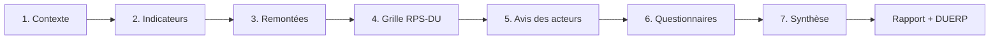
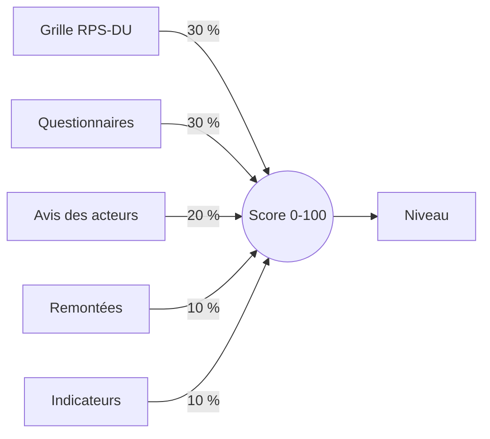

# Diagnostic RPS : étapes et méthode de calcul

Ce document explique comment fonctionne le diagnostic des risques psychosociaux (`rps.html`) : ce que l'on saisit à chaque étape, comment chaque résultat est calculé, à quoi il est comparé et ce que l'on fait ensuite des résultats.

> **À retenir.** Rien n'est obligatoire : ni les questions, ni les étapes. Le diagnostic se calcule avec les sources disponibles, et un **indice de fiabilité** indique à quel point le résultat est solide. Les pondérations et les seuils décrits ici sont des **repères de la méthode PréventIA**, inspirés de l'INRS et de l'Anact, mais **pas des normes validées**. Seul le COPSOQ est un questionnaire validé.

**Fichiers**

| Fichier | Rôle |
|---|---|
| `rps.html` | L'outil de l'infirmier·e en santé au travail : saisie, calculs, synthèse, rapport, envoi au DUERP |
| `rps-data.js` | Source unique des questions (baromètre, COPSOQ) et des indicateurs, partagée par les trois pages |
| `indicateurs-rps.html` | Page envoyée aux RH par lien sécurisé pour saisir les indicateurs |
| `enquete-rps.html` | Questionnaire anonyme des salariés, par lien ou QR code |

---

## Vue d'ensemble



Toutes les sources sont ramenées à un **score de 0 à 100 pour chacune des 7 familles de facteurs** (rapport Gollac, 2011). 0 = aucun risque, 100 = risque maximal.

| Code | Famille |
|---|---|
| f1 | Intensité et complexité du travail |
| f7 | Horaires de travail difficiles |
| f2 | Exigences émotionnelles |
| f3 | Faible autonomie au travail |
| f4 | Rapports sociaux au travail dégradés |
| f5 | Conflits de valeurs |
| f6 | Insécurité de l'emploi et du travail |

**Niveaux** (utilisés partout) : **< 25 faible · 25 à 49 modéré · 50 à 69 élevé · ≥ 70 critique**.

**Anonymat** : aucun résultat de questionnaire n'est affiché pour un groupe (entreprise ou équipe) de **moins de 5 réponses**. Les signaux infirmiers individuels ne sont utilisés qu'à partir de **5 salariés vus**.

---

## Étape 1 — Contexte

On renseigne l'entreprise, le secteur, le **code NAF**, l'effectif, la période et les équipes, avec leur effectif.

L'effectif sert à trois choses :
- choisir le mode des indicateurs : **essentiel sous 50 salariés** ou si l'effectif est inconnu, **complet** au-delà ;
- dire si le TF et le TG sont interprétables (pas sous 50 salariés) ;
- calculer le taux de participation aux questionnaires.

---

## Étape 2 — Indicateurs

Les indicateurs viennent de l'INRS (ED 6012 « Dépister les RPS, des indicateurs pour vous guider »). **Tous sont facultatifs.** Ils peuvent être saisis par l'infirmier·e, importés du suivi AT/MP de Protect, ou envoyés par les RH via `indicateurs-rps.html`.

### Mode essentiel ou complet

- **Essentiel : 9 indicateurs**, suffisants pour une petite structure. Ce sont l'absentéisme, le turnover, les heures supplémentaires, les AT avec arrêt, les arrêts de plus de 30 jours, les agressions du public, le harcèlement, les affections psychiques et les événements graves.
- **Complet : 27 indicateurs.** En mode essentiel, les 18 autres restent accessibles dans un bloc repliable « Indicateurs complémentaires ».
- Dans le code, un indicateur essentiel est marqué `ess:1` dans `rps-data.js`.

### Quand un indicateur passe-t-il en alerte ?

On saisit la valeur de la période N et celle de N-1. L'indicateur est en **alerte** dans l'un de ces cas :

| Règle | Exemples |
|---|---|
| Valeur ≥ repère | Absentéisme ≥ 5 % · turnover ≥ 15 % · intérim et CDD ≥ 15 % · entretiens annuels non faits ≥ 20 % · réorganisations ≥ 2 · conflits collectifs ≥ 1 · agressions du public ≥ 1 |
| Hausse de plus de 20 % par rapport à N-1 | Tous les indicateurs, y compris ceux sans repère |
| **Critique dès 1** | Harcèlement ou violences internes · affection psychique en AT/MP · événement grave |

**Heures supplémentaires** : elles sont saisies **par salarié et par mois**. Le repère est de **18 h par mois**, soit environ 4 h par semaine, ce qui correspond au contingent annuel de 220 h (art. D3121-24 du Code du travail). Les anciennes saisies annuelles sont converties automatiquement (÷ 12).

### TF et TG : comparaison au secteur

```
TF = AT avec arrêt × 1 000 000 ÷ heures travaillées
TG = jours d'arrêt × 1 000 ÷ heures travaillées
```

- On saisit dans la colonne « Repère » le **TF et le TG du secteur**, publiés par l'Assurance Maladie (statistiques de sinistralité par code NAF). L'outil affiche l'écart, par exemple « × 2,1 le secteur ».
- **Alerte** si l'entreprise atteint **1,5 fois le secteur** (`REF_SECT_X`), ou en cas de hausse de plus de 20 % sur N-1.
- **Moins de 50 salariés** (`TAUX_EFF_MIN`) : les taux s'affichent « Non interprétable », sans alerte. Sur un petit effectif, un seul accident fait varier le TF de plus de 10 points. Il vaut mieux suivre le nombre d'AT et de jours d'arrêt.

### Indicateurs par équipe

Une case d'équipe passe en alerte si elle dépasse le repère, **1,25 fois la valeur de l'entreprise** (pour un taux) ou **1,5 fois la valeur par salarié** (pour un nombre).

### Signaux individuels agrégés

L'infirmier·e saisit des **effectifs**, jamais de nom : nombre de salariés vus en entretien, plaintes de stress, troubles du sommeil, épuisement, consommations à risque, pré-dépistages burn-out à risque élevé. Ces données servent uniquement à estimer la **gravité** (voir l'étape 7), à partir de 5 salariés vus.

### Score « Indicateurs » d'une famille

Chaque indicateur est rattaché à une ou plusieurs familles (colonne « Facteurs éclairés »).

```
Score indicateurs = somme sur les indicateurs de la famille de : alerte = 25 · critique = 100   (plafond 100)
Pour une équipe : 35 points par indicateur d'équipe en alerte (plafond 100)
```

*Exemple :* la famille Rapports sociaux a l'absentéisme et le turnover en alerte (25 + 25) : son score est **50**.

---

## Étape 3 — Remontées et signalements

On consigne les situations rapportées (entretiens infirmiers, CSE, managers, RH…) avec leur date, leur source, l'équipe, la famille et la gravité. **Seules la date et la description sont obligatoires.**

```
Points par remontée non traitée : signal faible = 12 · situation à suivre = 24 · situation grave = 48
Score remontées = somme des points de la famille (plafond 100)
```

- Les remontées marquées « Traité » ne comptent plus.
- **Recueil au fil de l'eau** (par défaut) : une famille sans remontée n'est pas notée, ce qui évite un faux « tout va bien ».
- **Recueil systématique** (case à cocher) : l'absence de remontée compte comme 0.

---

## Étape 4 — Grille RPS-DU

C'est la grille INRS d'évaluation des RPS dans le document unique, avec 26 questions et 4 réponses possibles : Jamais/Non, Parfois/Plutôt non, Souvent/Plutôt oui, Toujours/Oui. Elle se remplit **par équipe**.

```
Niveau d'une question : 1 = favorable … 4 = élevé
  (pour une question formulée positivement, le niveau est inversé)
Score de la famille = (niveau moyen − 1) ÷ 3 × 100
  Si une question de la famille est au niveau « élevé », le score vaut au moins 50.
Score entreprise = moyenne des équipes pondérée par leur effectif
```

*Exemple :* trois questions aux niveaux 2, 2 et 3 donnent une moyenne de 2,33, soit un score de (2,33 − 1) ÷ 3 × 100 = **44**, niveau modéré.

---

## Étape 5 — Avis des acteurs

Chaque acteur donne un niveau par famille : 0 pas de difficulté · 1 vigilance · 2 difficultés · 3 préoccupant. Les acteurs sont l'infirmier·e, le médecin du travail, le CSE, les deux référents harcèlement, les RH, la direction et l'encadrement.

```
Score avis = moyenne des niveaux des acteurs ÷ 3 × 100
```

**Écarts de perception** : si deux acteurs diffèrent d'au moins **2 niveaux** sur une famille (par exemple la direction à 0 et le CSE à 2), l'outil le signale. C'est souvent un sujet à travailler en soi.

---

## Étape 6 — Questionnaires anonymes

Il y a deux questionnaires, au choix ou les deux. On y répond sur place en mode kiosque, à distance par lien ou QR code, ou via un formulaire Forms (plan B). **Aucune question n'est obligatoire.** Aucune identité et aucune heure de réponse ne sont enregistrées.

### 6.1 Baromètre PréventIA (repérage, environ 4 min)

C'est un questionnaire de **28 affirmations, 4 par famille**, plus 2 questions de santé perçue (épuisement, sommeil). Il n'est pas validé (voir plus bas comment le fiabiliser).

**Étape 1, les points de risque.** On répond sur une échelle de 0 à 3 : Jamais 0 · Parfois 1 · Souvent 2 · Toujours 3.

```
Affirmation négative (« Je dois travailler très vite ») : risque = réponse
Affirmation positive (« Je peux compter sur mes collègues ») : risque = 3 − réponse
```

**Étape 2, le score de la famille sur 100.** On regroupe toutes les réponses du groupe aux 4 affirmations de la famille :

```
Score = moyenne des points de risque ÷ 3 × 100
```

*Exemple :* famille Rapports sociaux, 4 affirmations et 10 répondants, soit 40 réponses. Elles totalisent 48 points de risque : 48 ÷ 40 = 1,2, puis 1,2 ÷ 3 × 100 = **40**, niveau modéré.

**Étape 3, les questions de santé.** L'outil affiche le **pourcentage de « souvent » ou « toujours »**.

**Étape 4, le détail par affirmation.** On calcule le même pourcentage pour chaque affirmation. Quatre affirmations sont comparées à l'enquête **Dares Conditions de travail et RPS 2024-2025**, par exemple « manque de temps » face à un repère de 25 %. Une affirmation est signalée « au-dessus » si elle dépasse **1,25 fois le repère**.

**Historique.** Le baromètre avait 25 affirmations en version 1. Trois ont été ajoutées en fin de liste (surcharge mentale, sollicitations hors horaires, pauses et congés) pour avoir 4 affirmations par famille. Les réponses étant enregistrées par position, **tout nouvel item s'ajoute en fin de liste**. Les anciennes réponses restent importables, et les numéros Forms B01 à B27 sont inchangés : les nouveaux items sont B28 à B30.

### 6.2 COPSOQ, version courte française (environ 10 min)

C'est un questionnaire validé de **46 questions et 24 échelles** (Dupret É., Bocéréan C. et al., *Santé Publique*, 2012), libre de droit. Ses libellés sont repris mot pour mot.

**Étape 1, la valeur des réponses.** Elles sont codées de 0 à 4 : Toujours = 4 … Jamais = 0. Les questions formulées à l'envers sont inversées (4 − réponse).

**Étape 2, le score d'une personne pour une échelle** (cotation de l'article de validation) :

```
Score = somme des réponses ÷ (4 × nombre de questions) × 100
Non calculé s'il manque une réponse à l'échelle.
```

*Exemple, Charge de travail :* « Prenez-vous du retard ? » → Souvent = 3. « Disposez-vous d'un temps suffisant ? » → Parfois = 2, inversé en 4 − 2 = 2. Le score vaut (3 + 2) ÷ 8 × 100 = **62,5**.

**Étape 3, le score du groupe** = moyenne des scores des personnes.

**Étape 4, la lecture par rapport à la référence française.** Un score brut de COPSOQ ne se lit pas seul. La moyenne de la population de référence pour le rythme de travail est par exemple de 65 sur 100. On compare donc chaque échelle à la **moyenne m et à l'écart-type σ de l'étude de validation** (3 166 salariés, aéronautique, 2010). C'est un ordre de grandeur, pas une norme.

```
z = écart défavorable à la référence, en écarts-types
    échelle où un score haut est défavorable (stress, charge…) : z = (score − m) ÷ σ
    échelle où un score haut est favorable (soutien, sens…)    : z = (m − score) ÷ σ
```

| Écart | Couleur | Score de risque 0-100 |
|---|---|---|
| z < 0 : meilleur que la référence | Vert | < 25 |
| 0 à ½ σ moins bon | Jaune | 25 à 50 |
| ½ à 1 σ moins bon | Orange | 50 à 70 |
| ≥ 1 σ moins bon | Rouge | ≥ 70 |

*Exemples :* un rythme de 73 (m = 65, σ = 19) donne z = 0,42, donc **jaune**. Un épuisement de 60 (m = 38, σ = 21) donne z = 1,05, donc **rouge**.

Quatre échelles n'ont pas de référence : exigences cognitives, conflit de rôles, insécurité professionnelle et santé auto-évaluée. Pour elles, on applique les seuils 25 / 50 / 70 au score brut orienté risque (`100 − score` pour une échelle favorable). Le code se trouve dans `copRiskRef()` de `rps.html`.

**Étape 5, le score de la famille.** C'est la moyenne pondérée des scores de risque des échelles de la famille. Les **exigences cognitives comptent pour moitié** (poids `w:.5`) : stimulantes à dose modérée, elles ne deviennent un facteur de risque qu'en excès, par l'épuisement mental.

| Famille | Échelles COPSOQ |
|---|---|
| Intensité | Charge, rythme, exigences cognitives (½) |
| Horaires | Conflit famille/travail |
| Émotions | Exigences émotionnelles |
| Autonomie | Marge de manœuvre, possibilités d'épanouissement |
| Rapports sociaux | Confiance et soutien des collègues, reconnaissance, équité, leadership, soutien et confiance du management |
| Valeurs | Clarté des rôles, conflit de rôles, sens du travail |
| Insécurité | Prévisibilité, insécurité professionnelle |

Le stress, l'épuisement, la santé, l'engagement et la satisfaction ne sont rattachés à aucune famille. Ils alimentent les **indicateurs de santé** et les **alertes**, par exemple un épuisement ≥ 50.

### 6.3 Score « Questionnaires » d'une famille

```
Score questionnaires = moyenne (baromètre, COPSOQ), selon ce qui est disponible
```

---

## Étape 7 — Synthèse

### 7.1 Score croisé par famille



```
Score = Σ (poids × score de la source) ÷ Σ (poids des sources disponibles)
```

Une **source absente est retirée** et les autres poids sont réajustés.

*Exemple :* grille = 50, questionnaires = 60, indicateurs = 50, sans avis ni remontées. Le calcul donne (0,3 × 50 + 0,3 × 60 + 0,1 × 50) ÷ 0,7 = 38 ÷ 0,7 = **54**, niveau élevé.

**Règle de sécurité** : une famille qui a une remontée grave non traitée ou un indicateur critique est classée **au moins « élevé »**, quel que soit son score.

### 7.2 Criticité et priorité (méthode Anact-Aract, kit « RPS dans le DU », 2017)

```
Criticité = Exposition × Gravité × coefficient de Maîtrise
```

| Terme | Valeurs | D'où il vient |
|---|---|---|
| **Exposition** (1 à 4) | faible 1 · modéré 2 · élevé 3 · critique 4 | Niveau du score croisé |
| **Gravité** (1 à 4) | légère · modérée · importante · grave | Proposée automatiquement (voir ci-dessous), modifiable |
| **Maîtrise** | aucune mesure × 1 · partielle × 0,8 · efficace × 0,5 | Choisie par l'infirmier·e |

**Gravité proposée automatiquement :**

- **4** : situation grave non traitée ou indicateur critique.
- **3** : au moins 20 % des salariés vus présentent un signal (stress, sommeil, épuisement…) ; ou au moins 2 remontées « à suivre » ou « graves » ; ou un indicateur de santé en alerte (affection psychique, arrêts longs, visites à la demande, inaptitudes, aménagements).
- **2** : au moins 10 % des salariés vus avec un signal, ou au moins une remontée ou un indicateur en alerte.
- **1** sinon.

Les pourcentages ne sont utilisés qu'à partir de 5 salariés vus.

**Priorité :**

| Criticité | Priorité |
|---|---|
| ≥ 10 | **P1** : immédiat |
| 6 à 9 | **P2** : sous 6 mois |
| 3 à 5 | **P3** : à planifier |
| < 3 | **P4** : surveiller |

Une gravité 4 n'est **jamais en dessous de P2**.

*Exemple :* exposition élevée (3) × gravité importante (3) × mesures partielles (0,8) = 7,2, arrondi à 7, donc **P2**.

### 7.3 Indice de fiabilité (0 à 100)

```
Fiabilité = (sources renseignées ÷ 5) × 60
          + (acteurs ayant donné un avis, plafond 6) ÷ 6 × 20
          + (participation aux questionnaires, plafond 60 %) ÷ 60 × 20
```

*Exemple :* 4 sources sur 5, 3 avis et 40 % de participation donnent 48 + 10 + 13 = **71**.

### 7.4 Rapport et DUERP

- Le **rapport** reprend le contexte, les sources mobilisées (dont la comparaison TF/TG au secteur), le niveau par famille et par équipe, les écarts de perception, les signaux agrégés (en %), les alertes et les actions proposées.
- Les familles **P1 à P3** peuvent être **proposées au DUERP** (onglet « À valider »). La correspondance est : exposition → fréquence, gravité → gravité, maîtrise → maîtrise. Rien n'est ajouté sans validation.

---

## Que fait-on des résultats ?

Les résultats sont des **signaux à croiser**, pas un verdict.

```
Résultats → Croisement → Restitution → Groupe de travail → Plan d'actions → DUERP → Suivi
```

1. **Croiser.** Un facteur est solide s'il ressort d'au moins deux sources : questionnaire, indicateurs, avis, remontées. C'est le rôle de la synthèse.
2. **Restituer collectivement** à la direction, puis au CSE et aux salariés. On ne présente que des résultats globaux, jamais une équipe de moins de 5 répondants, et on précise qu'il s'agit d'un repérage.
3. **Comprendre en groupe de travail** avec la direction, les managers, les représentants du personnel et le SPST. On cherche les causes dans l'organisation du travail réel, pas chez les personnes.
4. **Agir en priorité sur les familles P1 et P2 :**
   - **prévention primaire** d'abord, qui agit sur l'organisation : charge, moyens, horaires, rôle des managers, conduite du changement ;
   - puis secondaire (formation, espaces de discussion, régulation) ;
   - puis tertiaire (prise en charge, accompagnement de la reprise).
5. **Inscrire au DUERP**, et au PAPRIPACT dans les entreprises de 50 salariés ou plus, soumis au CSE (art. L4121-3-1).
6. **Suivre** les indicateurs chaque trimestre et **mesurer à nouveau à 12-18 mois** pour vérifier l'effet des actions.

> **Règle d'or** : ne pas interroger les salariés sans s'engager à restituer et à agir. Une enquête sans suite dégrade la confiance et augmente le risque qu'elle cherchait à mesurer.

Une **situation grave** (violence, détresse, idées suicidaires repérées) ne s'évalue pas dans le diagnostic. Selon l'INRS (ED 6403), elle se traite **sans attendre**, dans un temps dédié, avec le médecin du travail.

---

## Fiabiliser le baromètre (non validé)

Sans étude publiée, on ne peut pas dire le baromètre « validé ». On peut en revanche **mesurer sa fiabilité** au fil des campagnes :

| Étape | Comment | Seuil visé |
|---|---|---|
| Validité de contenu | Affirmations calées sur le rapport Gollac, relues par 3 à 5 experts (médecin du travail, IPRP, psychologue du travail) | Accord ≥ 80 % |
| Compréhension | 5 à 10 salariés reformulent chaque affirmation à voix haute | Aucune affirmation mal comprise |
| Cohérence interne | α de Cronbach par famille. Il faut au moins 4 affirmations par famille, d'où le rééquilibrage | α ≥ 0,70 |
| Validité convergente | Corrélation avec le COPSOQ chez les salariés qui remplissent les deux | r ≥ 0,5 |
| Stabilité | Même groupe interrogé à 2 semaines d'intervalle | Corrélation ≥ 0,7 |
| Structure | Analyse factorielle : les affirmations se regroupent-elles bien en 7 familles ? | Possible au-delà d'environ 200 réponses |

Tant que ces vérifications ne sont pas faites, le baromètre est présenté comme un **outil de repérage**, et ses seuils comme des conventions.

---

## Sources

- Gollac M., Bodier M. (dir.), *Mesurer les facteurs psychosociaux de risque au travail pour les maîtriser*, rapport du Collège d'expertise, 2011.
- INRS, ED 6012 *Dépister les RPS, des indicateurs pour vous guider* ; ED 6403 sur les situations graves ; grille RPS-DU.
- Réseau Anact-Aract, kit *Les RPS dans le document unique*, 2017 (critères classants, criticité).
- Dupret É., Bocéréan C., Teherani M., Feltrin M., « Le COPSOQ : un nouveau questionnaire français d'évaluation des risques psychosociaux », *Santé Publique* 2012 ; 24(3) : 189-207.
- Dares, enquête *Conditions de travail et risques psychosociaux* 2024-2025.
- Assurance Maladie – Risques professionnels, statistiques de sinistralité par code NAF.
- Code du travail : art. L4121-3-1 (DUERP, PAPRIPACT), D3121-24 (contingent d'heures supplémentaires), L1152-4 et L1153-5 (harcèlement).
